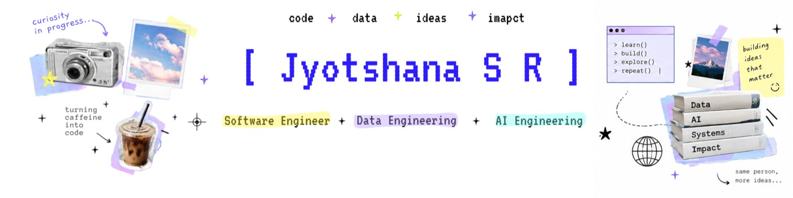
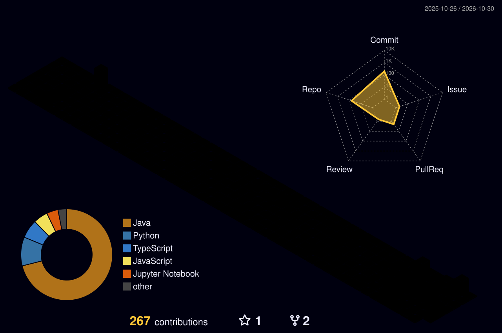

<div align="center">

  <!-- Header Banner -->
  

  <br/><br/>

  <!-- Retro Pixel-Inspired Title & Identity -->
  <code>✦ ✦ ✦</code>
  <h1>[ Jyotshana S R ]</h1>
  <p><strong><em>"Where curiosity becomes creation."</em></strong></p>

  <p>
    <strong>AI & Data Science</strong> · <strong>Microsoft Learn Student Ambassador</strong> · <strong>Saveetha Engineering College, Chennai</strong><br/>
    <em>Class of 2028</em>
  </p>

  <p>
    <a href="https://github.com/jyotshana666"></a>
    <a href="https://www.linkedin.com/in/jyotshana666"></a>
    <a href="mailto:jyo6niaa@gmail.com"></a>
    
  </p>

</div>

---

### ┌── [ 01 · ABOUT ME ] ───────────────────────────────────────────────┐

```text
  ┌────────────────────────────────────────────────────────────────────────┐
  │  def profile():                                                        │
  │      role        = "Undergraduate Engineer (B.Tech AI & Data Science)" │
  │      institution = "Saveetha Engineering College, Chennai"             │
  │      graduation  = "Class of 2028"                                     │
  │      focus_areas = ["Java Backend", "AI Systems", "Security & Auth"]   │
  │      mindset     = "Building deterministic systems for uncertain tech" │
  └────────────────────────────────────────────────────────────────────────┘
```

I am a software and security-focused engineer pursuing a **B.Tech in Artificial Intelligence and Data Science** at **Saveetha Engineering College, Chennai**. As a **Microsoft Learn Student Ambassador**, my work bridges robust system design, cryptographic identity protocols, and deterministic safety mechanisms for autonomous AI systems.

I build resilient backend architectures with **Java (SE 21)** and **Python**, construct zero-trust identity pipelines using biometric authentication and hardware-backed credentials (WebAuthn/FIDO2), and design runtime authorization gateways that prevent rogue agent behavior in enterprise environments.

---

### ┌── [ 02 · ENGINEERING FOCUS ] ──────────────────────────────────────┐

- **☕ High-Throughput Backend Engineering:** Designing maintainable, clean architectures in Java SE 21 and Spring Boot, optimizing database interactions, and implementing reliable RESTful interfaces.
- **🛡️ Identity & Zero-Trust Authentication:** Architecting authentication systems combining face biometrics, device trust telemetry, HMAC-SHA256 tokens, and server-side session hijacking detection.
- **🤖 AI Agent Runtime Security & Governance:** Developing pre-execution interception gateways, blast-radius limiters, and policy engines that enforce strict `ALLOW` / `REVIEW` / `BLOCK` guardrails on autonomous AI operations.
- **📊 Data Systems & Applied Machine Learning:** Writing optimized relational schemas (SQL), building resilient data pipelines, and deploying lightweight classification microservices.

---

### ┌── [ 03 · FEATURED PROJECTS ] ──────────────────────────────────────┐

<table>
  <tr>
    <td width="50%" valign="top">
      <h4>✦ <a href="https://github.com/jyotshana666/VaultBase">VaultBase</a></h4>
      <p><em>Passwordless biometric authentication ecosystem & identity protection suite</em></p>
      <ul>
        <li><strong>Biometric & FIDO2 Auth:</strong> Combines client-side face recognition (TensorFlow.js) with platform hardware authenticators (WebAuthn/FIDO2).</li>
        <li><strong>Device Trust Engine:</strong> Dynamically calculates risk scores across new, trusted, and revoked device states.</li>
        <li><strong>Session Protection:</strong> Issues HMAC-SHA256 OTPs and enforces server-side JWT session validation with JTI revocation and hijack detection.</li>
      </ul>
      <p>
        
        
        
        
      </p>
      <p>➔ <strong>Repository:</strong> <a href="https://github.com/jyotshana666/VaultBase"><code>jyotshana666/VaultBase</code></a></p>
    </td>
    <td width="50%" valign="top">
      <h4>✦ <a href="https://github.com/jyotshana666/Zentrix">Runtime Security Harness (Agent Warden-Z)</a></h4>
      <p><em>Intent-aware security gateway & runtime authorization engine for AI agents</em></p>
      <ul>
        <li><strong>Pre-Execution Interception:</strong> Evaluates proposed agent queries before execution to guarantee intent-to-action alignment.</li>
        <li><strong>Deterministic Decisions:</strong> Authoritatively renders <code>ALLOW</code>, <code>HOLD</code> (review), or <code>BLOCK</code> verdicts based on task policies.</li>
        <li><strong>Safety Analysis:</strong> Performs blast-radius estimation, reversibility validation, and behavioral trajectory drift monitoring with immutable SHA-256 audit trails.</li>
      </ul>
      <p>
        
        
        
      </p>
      <p>➔ <strong>Repository:</strong> <a href="https://github.com/jyotshana666/Zentrix"><code>jyotshana666/Zentrix</code></a></p>
    </td>
  </tr>
  <tr>
    <td colspan="2" valign="top">
      <h4>✦ <a href="https://github.com/jyotshana666/Shadow-Sentinal">Shadow Sentinel</a></h4>
      <p><em>Integrated enterprise AI governance console, telemetry collector & risk engine</em></p>
      <ul>
        <li><strong>Full-Stack Architecture:</strong> Manifest V3 Chrome telemetry extension feeding into a Spring Boot 3.3 ingestion and risk engine.</li>
        <li><strong>ML Policy Engine:</strong> FastAPI microservice performing dynamic classification and real-time site risk scoring.</li>
        <li><strong>SOC Observability:</strong> React 18 + TypeScript admin dashboard for threat hunting, telemetry auditing, and policy rule management.</li>
      </ul>
      <p>
        
        
        
        
      </p>
      <p>➔ <strong>Repository:</strong> <a href="https://github.com/jyotshana666/Shadow-Sentinal"><code>jyotshana666/Shadow-Sentinal</code></a></p>
    </td>
  </tr>
</table>

---

### ┌── [ 04 · TECHNICAL ARSENAL ] ──────────────────────────────────────┐

```text
  [ CORE TECH STACK ]
  ┌───────────────────────┬─────────────────────────────────────────────────┐
  │ CATEGORY              │ TECHNOLOGIES & TOOLS                            │
  ├───────────────────────┼─────────────────────────────────────────────────┤
  │ Languages             │ Java (SE 21), Python, SQL, TypeScript, JS, C   │
  │ Backend & APIs        │ Spring Boot 3, FastAPI, Node.js, REST APIs      │
  │ Security & Identity   │ WebAuthn/FIDO2, Biometrics, JWT, Zero-Trust     │
  │ AI & Data Science     │ PyTorch, TensorFlow.js, Scikit-learn, Pandas    │
  │ Databases & Storage   │ PostgreSQL, MySQL, SQLite, Redis                │
  │ DevOps & Tools        │ Git, GitHub Actions (CI/CD), Docker, Linux, MV3 │
  └───────────────────────┴─────────────────────────────────────────────────┘
```

<div align="center">

| Area | Technologies |
|:---|:---|
| **Languages** | `Java (SE 21)` · `Python 3.x` · `SQL` · `TypeScript` · `JavaScript (ES6+)` · `C` |
| **Backend & Architecture** | `Spring Boot 3` · `FastAPI` · `RESTful API Design` · `Clean Architecture` · `Microservices` |
| **Security & Identity** | `WebAuthn / FIDO2` · `Face Biometrics (TensorFlow.js)` · `JWT (JTI Revocation)` · `Device Trust Scoring` · `HMAC-SHA256` |
| **AI Systems & Safety** | `Agent Intent Verification` · `Runtime Authorization Harnesses` · `Blast-Radius Analysis` · `Scikit-Learn` · `PyTorch` |
| **Databases & Data Storage** | `PostgreSQL` · `MySQL` · `SQLite` · `Redis` · `Relational Schema Design` |
| **Tooling & Platform** | `Git` · `GitHub Actions (CI/CD)` · `Docker` · `Linux / Shell` · `Chrome Extensions (MV3)` · `Postman` |

</div>

---

### ┌── [ 05 · VERIFIED CERTIFICATIONS & HONORS ] ──────────────────────┐

- 🎓 **Oracle Certified Professional: Java SE 21 Developer** — Oracle University
- 📊 **DataCamp SQL Associate** — Comprehensive relational query design, data joining, and aggregation certification
- 🏆 **IBM Z Datathon 2026** — *Theme 2: AI Secured — Innovation Without Exposure* (Project Code: `SSF2026` for Agent Warden-Z)
- 🚀 **Flipkart Runway / Girls Wanna Code (GWC)** — Flipkart Technical Campus Program participant
- 🌟 **Microsoft Learn Student Ambassador** — Technical community leadership and technology advocacy

---

### ┌── [ 06 · CURRENT ENGINEERING PURSUITS ] ──────────────────────────┐

```text
  [ ACTIVE_SYSTEM_BUS ]
  ├─ [01] Deepening distributed systems knowledge: consensus protocols, event streaming, and fault tolerance.
  ├─ [02] Advancing runtime safety sandboxes and deterministic gateways for multi-agent LLM systems.
  └─ [03] Low-Level Design (LLD), concurrency paradigms in modern Java SE 21, and database indexing strategies.
```

---

### ┌── [ 07 · 3D CONTRIBUTION TOPOGRAPHY ] ────────────────────────────┐

<div align="center">

  <p><em>Real-time visualization of commit activity generated by automated daily workflow telemetry.</em></p>

  

  <p>
    <sub>Automated via <code>.github/workflows/profile-3d.yml</code> with <code>yoshi389111/github-profile-3d-contrib@v0.9.3</code> · Runs daily at 18:00 UTC and on-demand</sub>
  </p>

</div>

---

### ┌── [ 08 · DISPATCH & CONNECT ] ─────────────────────────────────────┐

```text
  ┌────────────────────────────────────────────────────────────────────────┐
  │  CONNECT WITH ME                                                       │
  │  Email       : jyo6niaa@gmail.com                                      │
  │  GitHub      : github.com/jyotshana666                                 │
  │  LinkedIn    : linkedin.com/in/jyotshana666                            │
  │  Location    : Chennai, India                                          │
  │  Status      : Open to SWE / Backend / Security & AI Internships       │
  └────────────────────────────────────────────────────────────────────────┘
```

<div align="center">

  [](https://github.com/jyotshana666)
  [](https://www.linkedin.com/in/jyotshana666)
  [](mailto:jyo6niaa@gmail.com)

  <br/><br/>
  <code>[ EOF · Jyotshana S R ]</code>

</div>
